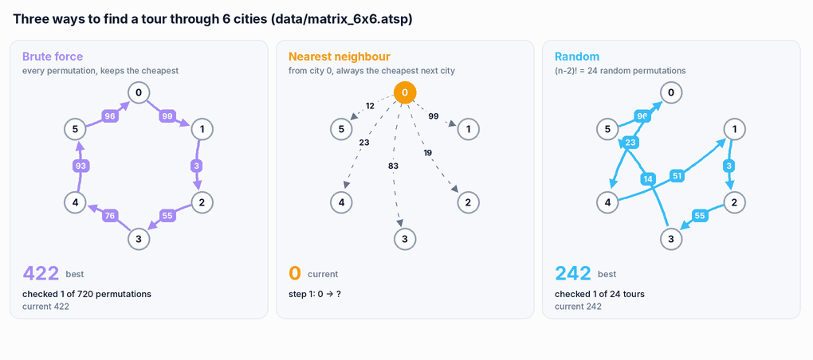
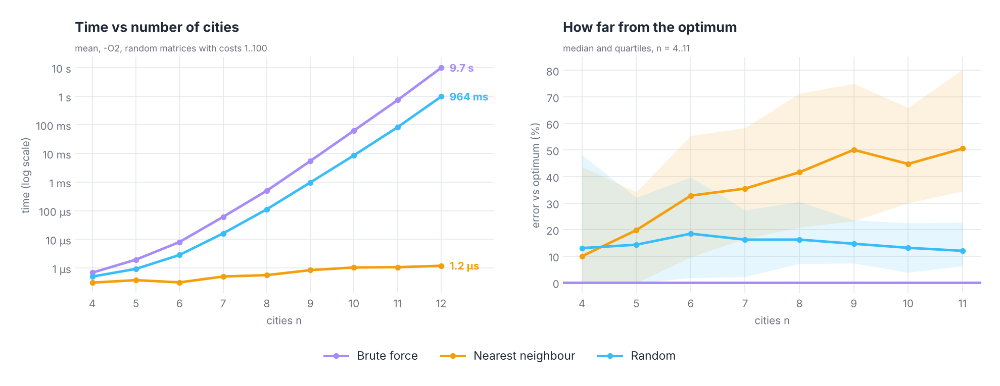

<p align="right">
  <a href="README.md"> <b>English</b></a>
  &nbsp;|&nbsp;
  <a href="README.pl.md"> Polski</a>
</p>

<a href="#see-it-in-action">
  <picture>
    <source media="(prefers-color-scheme: dark)" srcset="docs/banner-en-dark.svg" />
    <source media="(prefers-color-scheme: light)" srcset="docs/banner-en-light.svg" />
    
  </picture>
</a>

<p align="center">
  
  
  
  
  
</p>

<p align="center">
  <a href="#see-it-in-action"><b>Demo</b></a> &nbsp;·&nbsp;
  <a href="#the-algorithms"><b>Algorithms</b></a> &nbsp;·&nbsp;
  <a href="#results"><b>Results</b></a> &nbsp;·&nbsp;
  <a href="#correctness"><b>Correctness</b></a> &nbsp;·&nbsp;
  <a href="#getting-started"><b>Getting started</b></a> &nbsp;·&nbsp;
  <a href="#project-structure"><b>Structure</b></a>
</p>

**ATSP: Brute Force vs Heuristics** is the first project for the *Design of Efficient Algorithms* course (*Projektowanie Efektywnych Algorytmów*) at Wrocław University of Science and Technology. It solves the **asymmetric travelling salesman problem**, where going from city *i* to *j* can cost something different than going back, in three ways: **brute force** (checks every tour, always optimal), **nearest neighbour** (greedy, one pass) and **random search** (the best of (n−2)! random tours).

A console menu loads a cost matrix from a file or generates a random one, runs any of the algorithms and appends the time, tour and cost to a CSV file. A simulation mode runs all three on a series of random matrices, and `tools/benchmark` does the same automatically for 4 to 12 cities.

## See it in action

<p align="center">
  <picture>
    <source media="(prefers-color-scheme: dark)" srcset="docs/en/search-dark.gif" />
    <source media="(prefers-color-scheme: light)" srcset="docs/en/search-light.gif" />
    
  </picture>
</p>

<p align="center"><sub>All three algorithms on <code>data/matrix_6x6.atsp</code>. Brute force and nearest neighbour are replayed in the same order and with the same tie-breaking as the C++ code (checked against the program's output); the random panel shows one example run of 24 tours. Each arrow is a one-way cost, so 0 → 5 and 5 → 0 are different edges.</sub></p>

## Highlights

<table>
  <tr>
    <td width="25%" align="center"><h3>3 / 3</h3><sub>test files solved to their<br/>known optimum</sub></td>
    <td width="25%" align="center"><h3>725</h3><sub>random instances measured,<br/>4 to 12 cities</sub></td>
    <td width="25%" align="center"><h3>9.7 s</h3><sub>brute force on 12 cities;<br/>13 would take about 2 minutes</sub></td>
    <td width="25%" align="center"><h3>51% vs 12%</h3><sub>median error of nearest neighbour<br/>vs random search at 11 cities</sub></td>
  </tr>
</table>

- **One instance, three answers.** Every algorithm takes the same `TSPInstance` (the cost matrix), so their results can be compared directly.
- **Exact baseline.** Brute force gives the true optimum, which is what makes it possible to say how far the heuristics are from it.
- **Results to CSV.** Each run appends `algorithm | seconds | milliseconds | nanoseconds | tour | cost` to `BruteForceResults.csv`, `NearestNeighborResults.csv` or `RandomResults.csv`, with a decimal comma so the file opens directly in a Polish Excel.
- **Simulation mode.** Option 6 generates any number of random matrices of a chosen size and runs all three algorithms on each of them.

## The algorithms

| Algorithm | What it does | Tours evaluated | Complexity | Optimal? |
|---|---|---|---|---|
| Brute force | every permutation of the cities in lexicographic order (hand-written `next_permutation`), keeps the cheapest | n! | O(n · n!) | ✅ always |
| Nearest neighbour | starts in a random city and always goes to the cheapest unvisited one, then returns to the start | 1 | O(n²) | ❌ heuristic |
| Random | (n−2)! random permutations (Fisher-Yates with `rand()`), keeps the cheapest | (n−2)! | O(n · (n−2)!) | ❌ heuristic |

The cost of a tour is the sum of `d[a][b]` along the cycle, including the way back to the first city. The diagonal of the matrix is `-1` and never used.

The random search is not a cheap shortcut: for 12 cities it still evaluates 3.6 million tours, against 479 million for brute force. That is n(n−1) = 132 times fewer tours, but the time is only 10 times lower, because a random permutation costs far more to generate than the next one in lexicographic order.

## Results

Random matrices with costs 1…100, the time reported by each algorithm itself, `-O2`, one core. 100 instances for each n up to 10, 20 for n = 11 and 5 for n = 12 (brute force takes 10 s each there).

<p align="center">
  <picture>
    <source media="(prefers-color-scheme: dark)" srcset="docs/en/results-dark.png" />
    <source media="(prefers-color-scheme: light)" srcset="docs/en/results-light.png" />
    
  </picture>
</p>

| n | Brute force | Random | Nearest neighbour | Error: random | Error: nearest neighbour |
|---|---|---|---|---|---|
| 6 | 8.1 µs | 2.9 µs | 0.3 µs | 18.5% | 32.8% |
| 8 | 0.50 ms | 0.11 ms | 0.6 µs | 16.3% | 41.6% |
| 10 | 62.8 ms | 8.6 ms | 1.0 µs | 13.2% | 44.8% |
| 11 | 728 ms | 82.3 ms | 1.1 µs | 12.0% | 50.5% |
| 12 | 9.74 s | 964 ms | 1.2 µs | 4.6% | 54.7% |

*Error* is the median of (cost − optimum) / optimum. For n = 12 it comes from only 5 instances.

What the measurements show:

- **Brute force grows like n!.** Every extra city multiplies the time by about n: ×11.6 from 10 to 11 cities and ×13.4 from 11 to 12. Following the trend, 13 cities would take about 2 minutes, 14 about half an hour and 15 more than 7 hours.
- **Nearest neighbour is about 8 million times faster** than brute force at 12 cities (1.2 µs against 9.7 s), but its tours get worse as n grows: the median is 33% above the optimum at 6 cities and 51% at 11, and from 7 cities on it finds the optimum in fewer than 1 case in 10.
- **Random search beats nearest neighbour** from 6 cities on: it gives the better tour in 60% of the instances at n = 6, 91% at n = 10 and 95% at n = 11. On random asymmetric matrices a greedy choice that is cheap now often forces an expensive edge at the end of the tour, while (n−2)! samples are enough to land close to the optimum.
- **The start city matters a lot for nearest neighbour.** On `matrix_6x6.atsp` the six possible starts give tours from 150 (the optimum) to 265, and the program picks one of them at random. Running it from every start and keeping the best would cost n times more, still only O(n³).

## Correctness

| Check | Result |
|---|---|
| Brute force on `data/matrix_6x6`, `8x8`, `11x11` | ✅ 150, 136 and 149, equal to the `sum_min` stored in each file |
| Brute force on 725 random instances | ✅ used as the reference optimum, heuristics never go below it |
| Python replicas used for the GIF | ✅ same tours and costs as the C++ program: brute force on `6x6` and `8x8`, nearest neighbour on all three files |
| Nearest neighbour and random search | heuristics: correct tours, cost above the optimum as shown in [Results](#results) |

## Getting started

<p align="center">
  
</p>

**CLion:** open the folder and run `atsp`.

**Command line:**

```bash
cmake -S . -B build -DCMAKE_BUILD_TYPE=Release
cmake --build build
./build/atsp
```

| Menu | Action |
|---|---|
| 1 | brute force on the loaded matrix |
| 2 | nearest neighbour |
| 3 | random search |
| 4 | generate a random matrix: size and maximum cost, saved to a file you name |
| 5 | load a matrix from a file |
| 6 | simulation: number of matrices, their size and maximum cost; all three algorithms on each |
| 0 | exit |

Each algorithm prints its tour and cost, and appends the time to its CSV file in the working directory. Messages in the program are in Polish.

### Matrix files

```
6                     <- number of cities
-1 99 19 83 23 12     <- row i: cost from city i to every city j
 67 -1  3 71 85 74
...
```

The diagonal is `-1`. Anything after the matrix is ignored, so the test files keep their optimum in a `sum_min=` line. For option 5 you can type a path relative to the working directory or just the file name: if the file is not found there, the program also looks in the project's `data/` folder.

### Running the benchmark

```bash
./build/benchmark             # n = 4…12, 20 instances per n up to 10, fewer for 11 and 12
./build/benchmark 12 100 > results.csv
```

The output is CSV: `algorithm,n,instance,ms,cost,optimum`. The time comes from the CSV each algorithm writes, so it does not include loading or saving. With 100 instances the run takes under two minutes, most of it brute force on 12 cities.

## Project structure

```
.
├── src/
│   ├── main.cpp
│   ├── app/            # Menu, TSPSimulation (option 6)
│   ├── core/           # TSPInstance (cost matrix), Utilities (tour cost, random matrix, factorial)
│   ├── algorithms/     # BruteForceTSP, NearestNeighborTSP, RandomTSP
│   └── io/             # SaveToCSV
├── data/               # matrix_6x6, matrix_8x8, matrix_11x11 with their optimum
├── tools/benchmark.cpp # automatic measurements, CSV output
└── docs/               # README visuals (EN / PL, light / dark)
```

<details>
<summary><b>Notes on the code</b></summary>
<br/>

- Brute force goes through all n! permutations, but a cycle is the same no matter which city it starts from, so every tour is checked n times. Fixing city 0 as the start would give the same result after (n−1)! permutations, n times faster.
- The number of random tours, (n−2)!, is computed in an `int`, which overflows from n = 15 (13! is larger than 2³¹).
- Nearest neighbour calls `srand(time(NULL))` every time. In simulation mode the random search runs right after it, so within the same second it draws the same sequence of permutations (on a different matrix).
- `rand()` on MinGW returns at most 32 767, which is still enough for Fisher-Yates on a few dozen cities.

</details>

---

<p align="center">
  <sub>Wrocław University of Science and Technology · Design of Efficient Algorithms · Grzegorz Sienkiewicz</sub>
</p>
