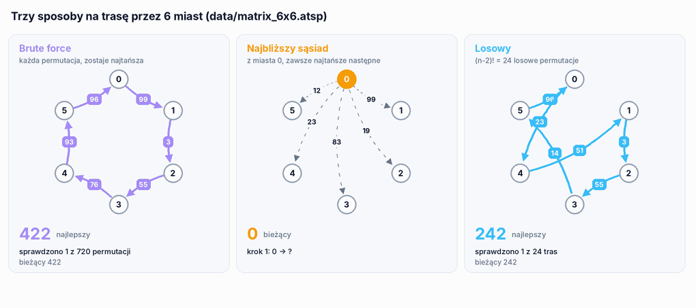
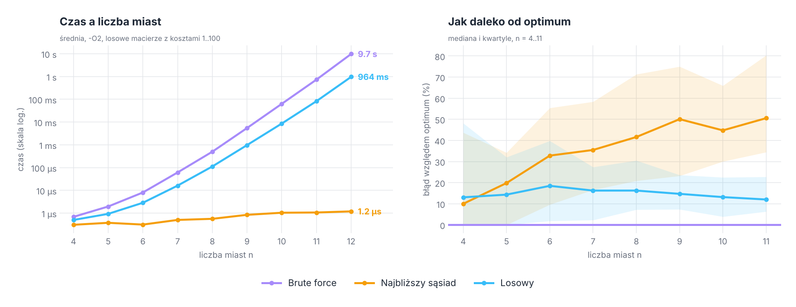

<p align="right">
  <a href="README.md"> English</a>
  &nbsp;|&nbsp;
  <a href="README.pl.md"> <b>Polski</b></a>
</p>

<a href="#zobacz-jak-działa">
  <picture>
    <source media="(prefers-color-scheme: dark)" srcset="docs/banner-pl-dark.svg" />
    <source media="(prefers-color-scheme: light)" srcset="docs/banner-pl-light.svg" />
    
  </picture>
</a>

<p align="center">
  
  
  
  
  
</p>

<p align="center">
  <a href="#zobacz-jak-działa"><b>Demo</b></a> &nbsp;·&nbsp;
  <a href="#algorytmy"><b>Algorytmy</b></a> &nbsp;·&nbsp;
  <a href="#wyniki"><b>Wyniki</b></a> &nbsp;·&nbsp;
  <a href="#poprawność"><b>Poprawność</b></a> &nbsp;·&nbsp;
  <a href="#uruchomienie"><b>Uruchomienie</b></a> &nbsp;·&nbsp;
  <a href="#struktura-projektu"><b>Struktura</b></a>
</p>

**ATSP: Brute Force vs Heuristics** to pierwszy projekt z kursu *Projektowanie Efektywnych Algorytmów* na Politechnice Wrocławskiej. Rozwiązuje **asymetryczny problem komiwojażera**, w którym przejazd z miasta *i* do *j* może kosztować inaczej niż powrót, na trzy sposoby: **przeglądem zupełnym** (sprawdza każdą trasę, zawsze optymalny), metodą **najbliższego sąsiada** (zachłannie, jedno przejście) i **przeszukiwaniem losowym** (najlepsza z (n−2)! losowych tras).

Menu w konsoli wczytuje macierz kosztów z pliku albo generuje losową, uruchamia dowolny algorytm i dopisuje czas, trasę i koszt do pliku CSV. Tryb symulacji uruchamia wszystkie trzy na serii losowych macierzy, a `tools/benchmark` robi to samo automatycznie dla 4 do 12 miast.

## Zobacz, jak działa

<p align="center">
  <picture>
    <source media="(prefers-color-scheme: dark)" srcset="docs/pl/search-dark.gif" />
    <source media="(prefers-color-scheme: light)" srcset="docs/pl/search-light.gif" />
    
  </picture>
</p>

<p align="center"><sub>Wszystkie trzy algorytmy na <code>data/matrix_6x6.atsp</code>. Brute force i najbliższy sąsiad są odtworzone w tej samej kolejności i z tym samym rozstrzyganiem remisów co w kodzie C++ (sprawdzone z wyjściem programu), panel losowy pokazuje jedno przykładowe uruchomienie z 24 trasami. Każda strzałka to koszt w jedną stronę, więc 0 → 5 i 5 → 0 to różne krawędzie.</sub></p>

## W skrócie

<table>
  <tr>
    <td width="25%" align="center"><h3>3 / 3</h3><sub>pliki testowe rozwiązane do<br/>znanego optimum</sub></td>
    <td width="25%" align="center"><h3>725</h3><sub>zmierzonych losowych instancji,<br/>od 4 do 12 miast</sub></td>
    <td width="25%" align="center"><h3>9,7 s</h3><sub>brute force dla 12 miast;<br/>13 zajęłoby około 2 minut</sub></td>
    <td width="25%" align="center"><h3>51% vs 12%</h3><sub>mediana błędu najbliższego sąsiada<br/>i losowania dla 11 miast</sub></td>
  </tr>
</table>

- **Jedna instancja, trzy odpowiedzi.** Każdy algorytm dostaje ten sam `TSPInstance` (macierz kosztów), więc wyniki można porównać bezpośrednio.
- **Dokładny punkt odniesienia.** Brute force daje prawdziwe optimum i właśnie dzięki temu wiadomo, jak daleko są od niego heurystyki.
- **Wyniki do CSV.** Każde uruchomienie dopisuje `algorytm | sekundy | milisekundy | nanosekundy | trasa | koszt` do `BruteForceResults.csv`, `NearestNeighborResults.csv` albo `RandomResults.csv`, z przecinkiem dziesiętnym, więc plik otwiera się od razu w polskim Excelu.
- **Tryb symulacji.** Opcja 6 generuje dowolną liczbę losowych macierzy wybranego rozmiaru i na każdej uruchamia wszystkie trzy algorytmy.

## Algorytmy

| Algorytm | Co robi | Ocenianych tras | Złożoność | Optymalny? |
|---|---|---|---|---|
| Brute force | każda permutacja miast w porządku leksykograficznym (własne `next_permutation`), zostaje najtańsza | n! | O(n · n!) | ✅ zawsze |
| Najbliższy sąsiad | startuje w losowym mieście i zawsze idzie do najtańszego nieodwiedzonego, na końcu wraca do startu | 1 | O(n²) | ❌ heurystyka |
| Losowy | (n−2)! losowych permutacji (Fisher-Yates z `rand()`), zostaje najtańsza | (n−2)! | O(n · (n−2)!) | ❌ heurystyka |

Koszt trasy to suma `d[a][b]` wzdłuż cyklu, łącznie z powrotem do pierwszego miasta. Przekątna macierzy to `-1` i nigdy nie jest używana.

Przeszukiwanie losowe nie jest tanim skrótem: dla 12 miast nadal ocenia 3,6 miliona tras wobec 479 milionów w brute force. To n(n−1) = 132 razy mniej tras, ale czas jest tylko 10 razy krótszy, bo wylosowanie permutacji kosztuje dużo więcej niż przejście do następnej w porządku leksykograficznym.

## Wyniki

Losowe macierze z kosztami 1…100, czas raportowany przez sam algorytm, `-O2`, jeden rdzeń. 100 instancji dla każdego n do 10, 20 dla n = 11 i 5 dla n = 12 (tam brute force trwa po 10 s).

<p align="center">
  <picture>
    <source media="(prefers-color-scheme: dark)" srcset="docs/pl/results-dark.png" />
    <source media="(prefers-color-scheme: light)" srcset="docs/pl/results-light.png" />
    
  </picture>
</p>

| n | Brute force | Losowy | Najbliższy sąsiad | Błąd: losowy | Błąd: najbliższy sąsiad |
|---|---|---|---|---|---|
| 6 | 8,1 µs | 2,9 µs | 0,3 µs | 18,5% | 32,8% |
| 8 | 0,50 ms | 0,11 ms | 0,6 µs | 16,3% | 41,6% |
| 10 | 62,8 ms | 8,6 ms | 1,0 µs | 13,2% | 44,8% |
| 11 | 728 ms | 82,3 ms | 1,1 µs | 12,0% | 50,5% |
| 12 | 9,74 s | 964 ms | 1,2 µs | 4,6% | 54,7% |

*Błąd* to mediana (koszt − optimum) / optimum. Dla n = 12 pochodzi tylko z 5 instancji.

Co pokazują pomiary:

- **Brute force rośnie jak n!.** Każde kolejne miasto mnoży czas mniej więcej przez n: ×11,6 z 10 na 11 miast i ×13,4 z 11 na 12. Idąc tym trendem, 13 miast zajęłoby około 2 minut, 14 około pół godziny, a 15 ponad 7 godzin.
- **Najbliższy sąsiad jest około 8 milionów razy szybszy** od brute force dla 12 miast (1,2 µs wobec 9,7 s), ale jego trasy pogarszają się wraz z n: mediana jest 33% powyżej optimum dla 6 miast i 51% dla 11, a od 7 miast trafia w optimum rzadziej niż w 1 przypadku na 10.
- **Przeszukiwanie losowe wygrywa z najbliższym sąsiadem** od 6 miast: daje lepszą trasę w 60% instancji dla n = 6, 91% dla n = 10 i 95% dla n = 11. Na losowych macierzach asymetrycznych wybór tani teraz często wymusza drogą krawędź na końcu trasy, a (n−2)! prób wystarcza, żeby trafić blisko optimum.
- **Miasto startowe bardzo zmienia wynik najbliższego sąsiada.** Na `matrix_6x6.atsp` sześć możliwych startów daje trasy od 150 (optimum) do 265, a program wybiera jeden z nich losowo. Uruchomienie z każdego startu i wybór najlepszej trasy kosztowałoby n razy więcej, czyli nadal tylko O(n³).

## Poprawność

| Sprawdzenie | Wynik |
|---|---|
| Brute force na `data/matrix_6x6`, `8x8`, `11x11` | ✅ 150, 136 i 149, zgodnie z `sum_min` zapisanym w każdym pliku |
| Brute force na 725 losowych instancjach | ✅ służy jako wzorcowe optimum, heurystyki nigdy nie schodzą poniżej |
| Kopie w Pythonie użyte do GIF-a | ✅ te same trasy i koszty co program C++: brute force na `6x6` i `8x8`, najbliższy sąsiad na wszystkich trzech plikach |
| Najbliższy sąsiad i przeszukiwanie losowe | heurystyki: poprawne trasy, koszt powyżej optimum jak w sekcji [Wyniki](#wyniki) |

## Uruchomienie

<p align="center">
  
</p>

**CLion:** otwórz folder i uruchom `atsp`.

**Wiersz poleceń:**

```bash
cmake -S . -B build -DCMAKE_BUILD_TYPE=Release
cmake --build build
./build/atsp
```

| Menu | Działanie |
|---|---|
| 1 | brute force na wczytanej macierzy |
| 2 | najbliższy sąsiad |
| 3 | przeszukiwanie losowe |
| 4 | wygenerowanie losowej macierzy: rozmiar i maksymalny koszt, zapis do pliku o podanej nazwie |
| 5 | wczytanie macierzy z pliku |
| 6 | symulacja: liczba macierzy, ich rozmiar i maksymalny koszt; wszystkie trzy algorytmy na każdej |
| 0 | wyjście |

Każdy algorytm wypisuje trasę i koszt, a czas dopisuje do swojego pliku CSV w katalogu roboczym.

### Pliki z macierzą

```
6                     <- liczba miast
-1 99 19 83 23 12     <- wiersz i: koszt z miasta i do każdego miasta j
 67 -1  3 71 85 74
...
```

Na przekątnej jest `-1`. Wszystko po macierzy jest pomijane, dlatego pliki testowe trzymają swoje optimum w linii `sum_min=`. W opcji 5 można podać ścieżkę względem katalogu roboczego albo samą nazwę pliku: jeśli program go tam nie znajdzie, szuka jeszcze w folderze `data/` projektu.

### Benchmark

```bash
./build/benchmark             # n = 4…12, 20 instancji na n do 10, mniej dla 11 i 12
./build/benchmark 12 100 > results.csv
```

Wynik to CSV: `algorithm,n,instance,ms,cost,optimum`. Czas pochodzi z CSV zapisywanego przez każdy algorytm, więc nie obejmuje wczytywania ani zapisu. Przy 100 instancjach pomiar trwa poniżej dwóch minut, głównie brute force dla 12 miast.

## Struktura projektu

```
.
├── src/
│   ├── main.cpp
│   ├── app/            # Menu, TSPSimulation (opcja 6)
│   ├── core/           # TSPInstance (macierz kosztów), Utilities (koszt trasy, losowa macierz, silnia)
│   ├── algorithms/     # BruteForceTSP, NearestNeighborTSP, RandomTSP
│   └── io/             # SaveToCSV
├── data/               # matrix_6x6, matrix_8x8, matrix_11x11 z optimum
├── tools/benchmark.cpp # automatyczne pomiary, wynik w CSV
└── docs/               # grafiki do README (EN / PL, jasne / ciemne)
```

<details>
<summary><b>Uwagi do kodu</b></summary>
<br/>

- Brute force przechodzi przez wszystkie n! permutacji, ale cykl jest ten sam niezależnie od miasta, od którego się zaczyna, więc każda trasa jest sprawdzana n razy. Ustalenie miasta 0 jako startu dałoby ten sam wynik po (n−1)! permutacjach, n razy szybciej.
- Liczba losowych tras, (n−2)!, jest liczona w `int`, który przepełnia się od n = 15 (13! jest większe niż 2³¹).
- Najbliższy sąsiad wywołuje `srand(time(NULL))` przy każdym uruchomieniu. W trybie symulacji przeszukiwanie losowe działa zaraz po nim, więc w obrębie tej samej sekundy losuje ten sam ciąg permutacji (na innej macierzy).
- `rand()` w MinGW zwraca najwyżej 32 767, co nadal wystarcza do Fishera-Yatesa dla kilkudziesięciu miast.

</details>

---

<p align="center">
  <sub>Politechnika Wrocławska · Projektowanie Efektywnych Algorytmów · Grzegorz Sienkiewicz</sub>
</p>
